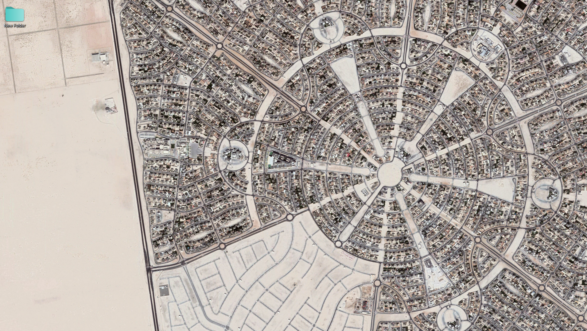

# The Art of Building Digital Experiences

*Published on October 20, 2026 · 5 min read*

Great digital experiences combine thoughtful design, clear communication, and carefully engineered interfaces. Whether you're building a personal portfolio or a complex web application, the details matter.



## 1. Start with a Clear Vision

Every successful project begins with a clear understanding of its purpose. Before writing code, consider:

- **Audience:** Who will use the product?
- **Purpose:** What problem does it solve?
- **Experience:** How should users feel when interacting with it?

A strong foundation makes every subsequent decision easier.

## 2. Design Before You Build

Visual references help translate abstract ideas into concrete interfaces. Mood boards, sketches, and prototypes are excellent ways to explore different directions.


> Good design is not just about how something looks. It's about how effectively it communicates and works.

### A Simple Design Workflow

1. Research the problem and audience.
2. Sketch multiple possible solutions.
3. Create a low-fidelity wireframe.
4. Build a working prototype.
5. Test with users and refine the result.

## 3. Bring the Design to Life

Modern frontend frameworks make it easier to build responsive and interactive experiences.

For example, here's a simple React component:

```tsx
export default function Welcome() {
  return (
    <section className="welcome">
      <h1>Ideas into Experiences</h1>
      <p>Design something meaningful.</p>
    </section>
  );
}
```

You can explore more in the [React documentation](https://react.dev/).

## 4. Pay Attention to the Details

Small decisions can have a significant impact on the final experience:

- Use consistent spacing and typography.
- Provide meaningful alternative text for images.
- Ensure interactive elements are keyboard-accessible.
- Optimize image sizes for faster loading.
- Test layouts on mobile, tablet, and desktop.


## 5. Useful Resources

Here are a few resources worth exploring:

- [MDN Web Docs](https://developer.mozilla.org/) — web development references.
- [Tailwind CSS](https://tailwindcss.com/) — utility-first styling.
- [shadcn/ui](https://ui.shadcn.com/) — reusable interface components.

---

## Final Thoughts

The best digital products are built through iteration. Start with a simple idea, test your assumptions, and improve the experience one decision at a time.

*What will you create next?*

---
